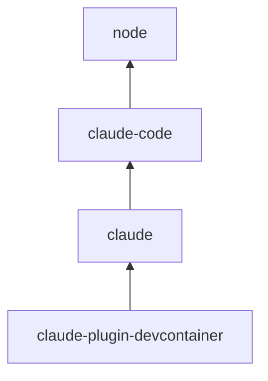

<h1 align="center">Dev Container Features</h1>

<p align="center">
  <strong>Claude Code in a devcontainer — Alpine Linux included.</strong>
</p>

<p align="center">
  <a href="LICENSE"></a>
  <a href="https://github.com/Cleler/devcontainer-features"></a>
  <a href="https://containers.dev/features"></a>
</p>

---

## Overview

This repository contains [Dev Container Features](https://containers.dev/implementors/features/) that bring Claude Code into a devcontainer, with a configuration shared between all your devcontainers. They work on Debian, Ubuntu and **Alpine Linux**, which the official `node` feature does not support. All the features are published to the GitHub Container Registry and can be referenced directly in any `devcontainer.json`:

```
ghcr.io/Cleler/devcontainer-features/<feature-name>
```

## Features

### claude

Claude Code (CLI and VS Code extension) with a configuration shared between all your devcontainers and independent from the host's own Claude Code: settings, history and authentication persist from one container to another.

**Key benefits:**
- Log in once: the credentials are stored in a host folder shared by every devcontainer
- Managed settings and `CLAUDE.md` deployed at Claude Code's managed level (each one can be turned off)
- Installs Node.js first, on Debian, Ubuntu and Alpine

[📖 Documentation](./src/claude/README.md)

### claude-plugin-devcontainer

A Claude Code plugin (`devcontainer`) with the skills and agents for working in a devcontainer: create, update, validate and fix a project's devcontainer. Depends on `claude`, so adding the plugin alone is enough.

**Key benefits:**
- Skills (`auto`, `compose`, `config`, `dockerfile`, `features`, `fix`, `guide`, `guided`, `status`, `update`, `validate`) and agents (`builder`, `maintainer`, `planner`, `reviewer`, `scout`, `troubleshooter`)
- Loaded through `CLAUDE_CODE_PLUGIN_DIRS`: nothing to install by hand

[📖 Documentation](./src/claude-plugin-devcontainer/README.md)

### claude-code

A copy of the official [`claude-code`](https://github.com/anthropics/devcontainer-features/tree/main/src/claude-code) feature that depends on this repository's `node`, so Node.js and npm are always installed first, and that no longer installs Node.js itself. It installs the Claude Code CLI globally. You don't need to add it yourself when you use `claude`.

**Key benefits:**
- Right installation order, which the official feature can't guarantee with another `node` feature
- Works on Alpine

[📖 Documentation](./src/claude-code/README.md)

### node

A copy of the official [`node`](https://github.com/devcontainers/features/tree/main/src/node) feature (Node.js via nvm, yarn, pnpm) with Alpine (apk) support added on top of the official code.

**Key benefits:**
- Everything the official feature does on Debian, Ubuntu and the RHEL family
- On Alpine: the musl builds of Node.js, nvm, yarn, pnpm and the node-gyp tools

[📖 Documentation](./src/node/README.md)

## Usage

Features from this repository are available via GitHub Container Registry. Reference them in your `devcontainer.json`:

```json
{
    "features": {
        "ghcr.io/Cleler/devcontainer-features/claude:1": {},
        "ghcr.io/Cleler/devcontainer-features/claude-plugin-devcontainer:1": {}
    }
}
```

### Requirements

The host directory shared by all devcontainers must exist before a container is created (Docker refuses to bind-mount a missing path, and a Feature can't create it for you):

```bash
mkdir -p ~/.claude/devcontainer
```

Then log in (`/login`) the first time: every other devcontainer is already authenticated.

## Available Features

| Feature | Description | Documentation |
|---------|-------------|---------------|
| [claude](./src/claude) | Claude Code CLI + VS Code extension, config shared between all devcontainers | [README](./src/claude/README.md) |
| [claude-plugin-devcontainer](./src/claude-plugin-devcontainer) | Claude Code plugin with the skills and agents to work on a devcontainer (depends on `claude`) | [README](./src/claude-plugin-devcontainer/README.md) |
| [claude-code](./src/claude-code) | Claude Code CLI, installed after `node` (copy of the official feature) | [README](./src/claude-code/README.md) |
| [node](./src/node) | Node.js via nvm, yarn, pnpm, with Alpine support (copy of the official feature) | [README](./src/node/README.md) |

## Dependency Graph

Each feature `dependsOn` the next one, so adding the first one installs everything, in order:



## Ready-to-Copy Stacks

### Claude Code with a specific Node.js

Declare `node` yourself to choose its version; the others use it:

```jsonc
{
  "features": {
    "ghcr.io/Cleler/devcontainer-features/node:1": { "version": "22" },
    "ghcr.io/Cleler/devcontainer-features/claude:1": {}
  }
}
```

### On Alpine

```jsonc
{
  "image": "mcr.microsoft.com/devcontainers/base:alpine",
  "features": {
    "ghcr.io/Cleler/devcontainer-features/claude:1": {},
    "ghcr.io/Cleler/devcontainer-features/claude-plugin-devcontainer:1": {}
  }
}
```

## Development

This repository follows the [Dev Container Features specification](https://containers.dev/implementors/features/). The rules of the repository (structure, tests, versions, CI) are in [AGENTS.md](./AGENTS.md).

### Testing

Features can be tested locally using the [Dev Container CLI](https://github.com/devcontainers/cli):

```bash
# Test a feature (autogenerated tests and scenarios)
devcontainer features test -f node .

# Test the scenarios that combine several features
devcontainer features test --global-scenarios-only .
```

A `dependsOn` is resolved from the published registry, not from `src/`: see [AGENTS.md](./AGENTS.md#testing).

### Publishing

Publishing is automatic. After each push on `main`, the [Automated Maintenance](.github/workflows/automated-maintenance.yaml) workflow:

- increments the patch version of each feature whose code changed since its last release (`README.md` and `NOTES.md` changes don't count; for a bigger change, increment the version yourself in `devcontainer-feature.json`),
- regenerates the READMEs that are not what `NOTES.md` and `devcontainer-feature.json` generate,
- puts both in one pull request (`automated-maintenance-<date>`), merged automatically once its checks pass, whose `release / check` publishes the new versions to GHCR with one annotated tag per feature (`feature_<id>_<version>`, as in the official features),
- publishes directly a feature whose version has no tag yet (a new feature, a version you incremented yourself).

It needs a GitHub App (secrets `APP_ID` and `APP_PRIVATE_KEY`, with the *Contents* and *Pull requests* write permissions, installed on this repository) and *Allow auto-merge* in the repository settings. By default, GHCR packages are `private`: mark each one as `public` in its package settings.

## Contributing

Contributions are welcome! Please follow the established feature structure ([AGENTS.md](./AGENTS.md)) and test your changes before submitting.

1. Fork the repository
2. Create a feature branch
3. Add your feature or fix following the established patterns
4. Test it
5. Submit a pull request

## License

This project is licensed under the MIT License, see the [LICENSE](LICENSE) file for details.

## Acknowledgments

Inspired by the official [Dev Containers Features](https://github.com/devcontainers/features) repository, from which `node` is taken, and by Anthropic's [`claude-code`](https://github.com/anthropics/devcontainer-features) feature. The structure of this repository and of its documentation follows [helpers4/devcontainer](https://github.com/helpers4/devcontainer).
