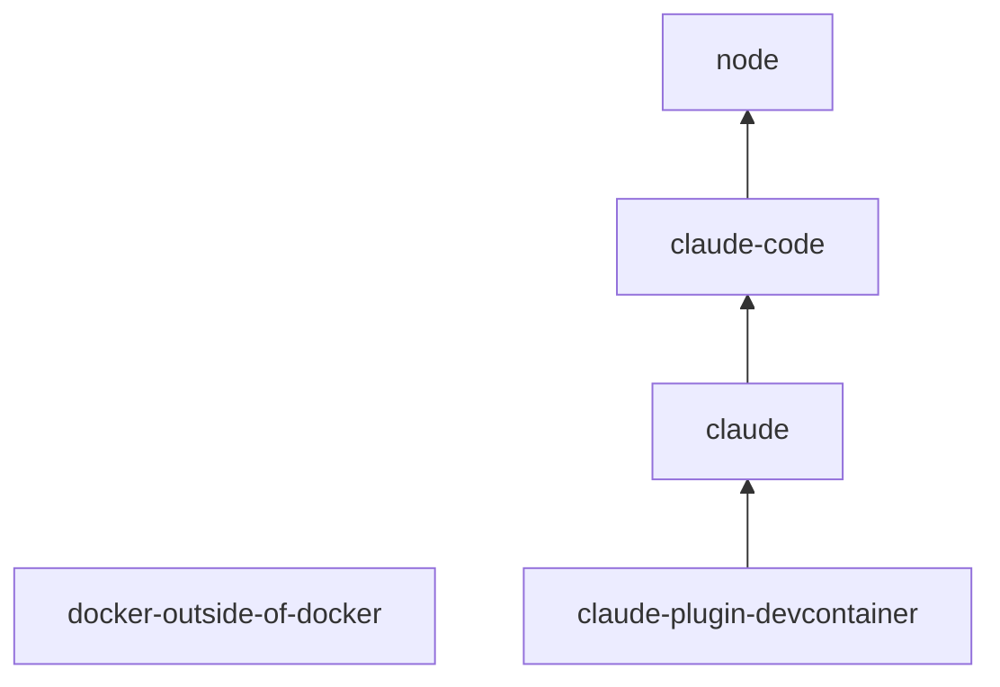

<h1 align="center">Dev Container Features</h1>

<p align="center">
  <strong>A registry of Dev Container Features.</strong>
</p>

<p align="center">
  <a href="LICENSE"></a>
  <a href="https://github.com/Cleler/devcontainer-features"></a>
  <a href="https://containers.dev/features"></a>
</p>

---

## Overview

This repository is a registry of [Dev Container Features](https://containers.dev/implementors/features/), published to the GitHub Container Registry. Each feature can be referenced directly in any `devcontainer.json`:

```
ghcr.io/Cleler/devcontainer-features/<feature-name>
```

The features are independent of each other. When one needs another, it declares it with `dependsOn` and the other one is installed automatically: see the [Dependency Graph](#dependency-graph).

## Features

### claude

Claude Code (CLI and VS Code extension) with a configuration shared between all devcontainers and independent from the host's own installation.

[📖 Documentation](./src/claude/README.md)

### claude-code

The Claude Code CLI, installed globally.

[📖 Documentation](./src/claude-code/README.md)

### claude-plugin-devcontainer

A Claude Code plugin (`devcontainer`) with the skills and agents for working in a devcontainer.

[📖 Documentation](./src/claude-plugin-devcontainer/README.md)

### docker-outside-of-docker

The Docker CLI, using the host's Docker socket.

[📖 Documentation](./src/docker-outside-of-docker/README.md)

### node

Node.js (via nvm), yarn and pnpm.

[📖 Documentation](./src/node/README.md)

## Usage

Reference the features you want in your `devcontainer.json`:

```json
{
    "features": {
        "ghcr.io/Cleler/devcontainer-features/node:1": {},
        "ghcr.io/Cleler/devcontainer-features/claude:1": {}
    }
}
```

Each feature documents its options and its requirements in its own README.

## Available Features

| Feature | Description | Depends on | Documentation |
|---------|-------------|------------|---------------|
| [claude](./src/claude) | Claude Code CLI + VS Code extension, configuration shared between all devcontainers | `claude-code` | [README](./src/claude/README.md) |
| [claude-code](./src/claude-code) | Claude Code CLI | `node` | [README](./src/claude-code/README.md) |
| [claude-plugin-devcontainer](./src/claude-plugin-devcontainer) | Claude Code plugin with skills and agents for working in a devcontainer | `claude` | [README](./src/claude-plugin-devcontainer/README.md) |
| [docker-outside-of-docker](./src/docker-outside-of-docker) | Docker CLI (Buildx, Compose) using the host's Docker socket | — | [README](./src/docker-outside-of-docker/README.md) |
| [node](./src/node) | Node.js via nvm, yarn, pnpm | — | [README](./src/node/README.md) |

## Dependency Graph

An arrow means "depends on": the feature at the end of the arrow is installed along with the other one.



## Development

This repository follows the [Dev Container Features specification](https://containers.dev/implementors/features/). The rules of the repository (structure, tests, versions, CI) are in [AGENTS.md](./AGENTS.md).

### Testing

Features can be tested locally using the [Dev Container CLI](https://github.com/devcontainers/cli):

```bash
# Test a feature (autogenerated tests and scenarios)
devcontainer features test -f node .

# Test the scenarios that combine several features
devcontainer features test --global-scenarios-only .
```

### Publishing

Publishing is automatic. After each push on `main`, the [Automated Maintenance](.github/workflows/automated-maintenance.yaml) workflow:

- increments the patch version of each feature whose code changed since its last release (`README.md` and `NOTES.md` changes don't count; for a bigger change, increment the version yourself in `devcontainer-feature.json`),
- regenerates the READMEs that are not what `NOTES.md` and `devcontainer-feature.json` generate,
- puts both in one pull request (`automated-maintenance-<date>`), merged automatically once its checks pass, whose `release / check` publishes the new versions to GHCR with one annotated tag per feature (`feature_<id>_<version>`),
- publishes directly a feature whose version has no tag yet (a new feature, a version you incremented yourself).

It needs a GitHub App (secrets `APP_ID` and `APP_PRIVATE_KEY`, with the *Contents* and *Pull requests* write permissions, installed on this repository) and *Allow auto-merge* in the repository settings. By default, GHCR packages are `private`: mark each one as `public` in its package settings.

## Contributing

Contributions are welcome! Please follow the established feature structure ([AGENTS.md](./AGENTS.md)) and test your changes before submitting.

1. Fork the repository
2. Create a feature branch
3. Add your feature or fix following the established patterns
4. Test it
5. Submit a pull request

## License

This project is licensed under the MIT License, see the [LICENSE](LICENSE) file for details.

## Acknowledgments

Inspired by the official [Dev Containers Features](https://github.com/devcontainers/features) repository.
